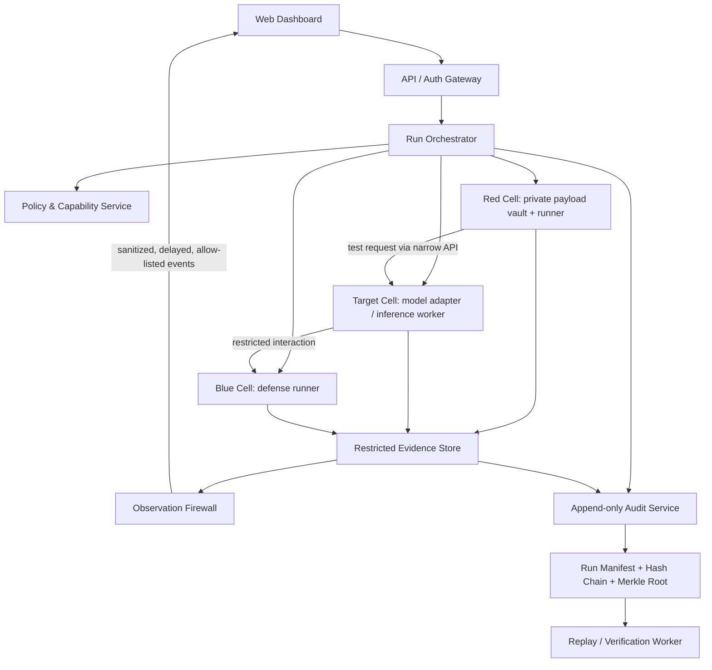

# BAYORA VEIL - PS-04 Prototype Blueprint
## Verifiable Evaluation Isolation Layer

> **Purpose:** Build a working proof of concept for Hack in Hills ’26 Problem Statement 04: *Securing Adversarial AI Safety Testing Infrastructure - Bayora*.
>
> **Core thesis:** Do not build “three Docker containers and a dashboard.” Build a small evaluation protocol that keeps Red Team payloads, Blue Team defenses, and the target model isolated while controlling what information may cross boundaries and producing tamper-evident evidence.
>
> **Novelty note:** This is a proposed architecture combining known security primitives. Do not claim that no one in the world has implemented a similar idea without a formal prior-art review. Demonstrate the distinct composition: **Observation Firewall + Blind Evaluation Protocol + Leakage Measurement + Verifiable Evidence**.

---

## 1. Problem to solve

The PS-04 brief identifies a shared Docker-based sandbox as a risk because Red Team, Blue Team, and the client LLM run in a common environment. The prototype must demonstrate:

- Red Team payloads are not visible to Blue Team before a test concludes.
- Blue Team defensive logic is not exposed to Red Team.
- The target LLM is isolated from test orchestration and cross-session contamination.
- Environmental leakage and cross-tenant interference are reduced and measured.
- Audit records are tamper-evident and can reconstruct an evaluation.
- The design can run on ordinary cloud infrastructure without proprietary hardware.
- LLM-specific risks-prompt/context leakage, inference-time exfiltration, cache/session contamination, timing and resource side channels-are considered.
- Residual risks and conditions where guarantees fail are communicated honestly.

## 2. Product concept

**BAYORA VEIL** = Verifiable Evaluation Isolation Layer.

A small control plane coordinates isolated execution domains and releases only approved, sanitized observations.

### Main innovation: the Observation Firewall

The target model's raw prompt, hidden attack payload, private defense rules, internal logs, and raw tool traces are never sent directly to the opposing team. Instead, the firewall transforms permitted outputs into a constrained observation schema.

Example:

```json
{
  "run_id": "run_001",
  "case_id": "case_007",
  "outcome": "policy_violation",
  "severity": "high",
  "category": "instruction_hierarchy",
  "confidence": 0.91,
  "evidence_digest": "sha256:...",
  "released_after_phase": "evaluation_closed"
}
```

This is illustrative data, not a claim of measured accuracy. The firewall must not include raw prompts, secrets, full model responses, defense rules, or unfiltered stack traces.

### Blind Evaluation Protocol

1. **Prepare:** The orchestrator creates a run and locks its policy/configuration version.
2. **Commit:** Red Team stores payloads in its private vault and submits a cryptographic commitment to the orchestrator.
3. **Execute:** The target model receives a test through a narrow, schema-validated interface. The target has no direct access to Red Team storage or Blue Team files.
4. **Defend:** Blue Team applies its defense to the model interaction using only its permitted inputs. It cannot read Red Team payload files or hidden test labels.
5. **Observe:** The evaluator records raw evidence in a restricted evidence store. The Observation Firewall emits only allow-listed, minimized telemetry.
6. **Close:** The run is frozen. Access policies change so neither team can modify artifacts.
7. **Reveal selectively:** Only after closure, authorized evaluators can reveal the payload or evidence necessary to validate a finding.
8. **Seal:** The system hashes event records, chains them, builds a Merkle root for the run, and signs the final manifest with an evaluation key.
9. **Replay:** An auditor can replay the recorded sequence in a clean run and compare output and evidence digests.

A hash chain or Merkle root makes tampering detectable only if the root/key and trust boundary are protected. It does not make a compromised host trustworthy by itself.

---

## 3. System architecture



**Important boundary rule:** The diagram shows logical flows. Enforce boundaries with separate processes/containers, separate service credentials, default-deny networking, read-only mounts where practical, and narrow APIs. Boxes in a diagram are not isolation.

### Execution domains

- **Control plane:** API, run state machine, policy checks, schedule, audit orchestration. No raw secret payload access by default.
- **Red Cell:** Red Team runner and private payload store. Blue cannot read its filesystem, environment variables, logs, or API endpoints.
- **Target Cell:** Model adapter and per-run context. It receives only the current test request; no shared conversation history between runs.
- **Blue Cell:** Defensive component with a private rules/config store. Red cannot read its files or debug endpoint.
- **Evidence domain:** Restricted raw traces plus a separate sanitized telemetry stream. Teams cannot query raw evidence during a blind run.
- **Audit domain:** Append-only event records and signed run manifest; read-only verification interface.

---

## 4. Recommended technology stack

Choose the smallest stack the team can finish and explain. Avoid spending the hackathon integrating too many experimental tools.

| Layer | Technology | Reason |
|---|---|---|
| Frontend | Vite + React + TypeScript | Fast dashboard development |
| Styling | Tailwind CSS or CSS modules | Flexible and lightweight |
| Backend API | Node.js + Express + TypeScript | Simple orchestration API |
| Validation | Zod | Runtime validation of API payloads |
| Database | PostgreSQL | Runs, users, policies, findings, manifests |
| Queue / jobs | Redis + BullMQ (optional) | Async evaluation and replay jobs |
| Model adapter | Python + FastAPI | Separate model integration from Node control plane |
| Local model | Ollama API or deterministic mock | Local demo; mock fallback keeps it reproducible |
| Isolation | Docker Compose, separate containers/networks | Demonstrable baseline boundary |
| Stronger sandbox (stretch) | gVisor or Firecracker | Stronger runtime boundary; choose one initially |
| Secrets | Docker secrets for demo; cloud secret manager in deployment | Avoid secrets in source/logs |
| Audit hashes | SHA-256 hash chain and Merkle root | Detect event/manifest changes |
| Signatures | Ed25519 via maintained crypto library | Verify signed run manifest |
| Testing | Vitest, Supertest, Pytest | Unit/API/integration tests |
| Observability | Structured JSON logs; OpenTelemetry (stretch) | Debug without dumping secrets |
| Deployment | Docker Compose locally; standard VM/cloud | Reproducibility |

**Do not implement your own cryptographic primitives.** Use maintained libraries and document the threat model.

### Stronger deployment profile (not required for MVP)

- Rootless containers, seccomp profiles, dropped Linux capabilities, read-only root filesystems.
- Default-deny network policy between cells.
- cgroup CPU/memory limits and bounded request queues.
- gVisor or Firecracker for an additional boundary if supported.
- Confidential computing and remote attestation only as a future extension unless hardware/cloud support is available. Do not pretend ordinary Docker proves hardware-backed attestation.

---

## 5. Threat model

### Protect against in the prototype

- Accidental cross-team API access.
- Reading another cell's files or environment through ordinary application paths.
- Payload disclosure through dashboard endpoints or logs.
- Unauthorized access to raw traces during a blind run.
- Cross-run conversation/context reuse.
- Event modification detectable by hash-chain verification.
- Basic resource exhaustion via per-run timeout and resource limits.
- Obvious prompt-injection attempts that try to reveal system instructions or secrets.

### Not fully solved by a hackathon prototype

- Kernel, hypervisor, host root, or cloud control-plane compromise.
- Sophisticated CPU cache, power, memory bus, or hardware timing side channels.
- All semantic leakage through model outputs.
- A malicious administrator who controls the host and signing key.
- Cryptographic key compromise.
- Formal proof of noninterference.
- Correctness of every LLM safety label.
- Complete prevention of exfiltration in every tool-enabled model.

The UI must distinguish **blocked**, **detected**, **not tested**, and **out of scope**. Never display “100% secure” or “zero leakage” as a result.

---

## 6. Security controls

### 6.1 Isolation by default

- Give each service a separate container and service identity.
- Use default-deny networking. Permit only documented calls through the orchestrator/API.
- Do not mount the Docker socket inside application containers.
- Never run untrusted payload code as root.
- Use non-root users, resource limits, read-only filesystems where practical, and explicit timeouts.
- Do not put Red and Blue secrets in a shared `.env` file in production.
- Avoid shared volumes between Red, Blue, and Target.
- Do not expose debug, metrics, or health endpoints that reveal secrets.

### 6.2 Capability-based authorization

Each internal request should have a scoped identity and permission set, for example:

- `red.submit_payload`
- `target.execute_case`
- `blue.read_sanitized_observation`
- `auditor.read_closed_run_evidence`
- `audit.append_event`

Enforce permissions in the backend, not just in the frontend. A hidden button is not access control.

### 6.3 Observation Firewall

Implement an allow-list schema, not a deny-list sanitizer. For example, release:

- run/case identifiers that do not encode secrets,
- coarse outcome categories,
- bounded severity/confidence,
- evidence digest,
- event timestamp rounded or delayed when needed.

Do not release raw prompts, hidden labels, secrets, raw stack traces, exact high-resolution timing, private defense rules, or unrestricted model output to the opposing team.

### 6.4 Side-channel controls

For the MVP:

- normalize or bucket durations before release,
- avoid live per-token timing for opposing teams,
- use fixed-size response envelopes where practical,
- cap concurrency and allocate resource budgets per cell,
- queue public status updates to reduce timing inference,
- ensure one tenant cannot query another tenant's metrics,
- run repeated controlled tests to compare leakage with and without mitigations.

These controls reduce selected channels; they do not eliminate all side channels.

### 6.5 Model session hygiene

- Start a fresh model conversation/session for each test case.
- Do not share KV cache or conversation IDs across tenants if configurable.
- Do not give the target unrestricted filesystem, network, shell, or tool access.
- If the target model is external, send only minimum data and disclose provider-side processing is outside the local isolation boundary.
- Prefer a local model or deterministic mock for a reproducible offline demo.

---

## 7. Cryptographic provenance and replay

Every event should include:

```json
{
  "event_id": "evt_000042",
  "run_id": "run_001",
  "sequence": 42,
  "event_type": "observation_released",
  "timestamp": "2026-01-01T12:00:00Z",
  "actor": "observation-firewall",
  "payload_digest": "sha256:...",
  "previous_event_hash": "sha256:...",
  "event_hash": "sha256:..."
}
```

For canonical event bytes `E_i`, calculate:

`H_i = SHA256(canonical(E_i) || H_(i-1))`

Use a fixed genesis hash for the first event. Canonical serialization must be deterministic. The verifier recomputes every hash and checks sequence continuity.

At run closure:

1. Sort event hashes by sequence.
2. Build a Merkle tree.
3. Create a manifest containing run ID, policy version, model adapter/version, dataset version, event count, Merkle root, and final chain hash.
4. Sign the manifest with Ed25519.
5. Store signature and public verification key separately from ordinary event writers.
6. Provide a verifier that detects changed, deleted, reordered, or missing events.

A local demo key proves integrity relative to that key, not identity from an external trusted authority. Protect the key and state this limitation.

---

## 8. Leakage measurement: the standout feature

Do not only claim that information is hidden. Run controlled experiments to measure whether the opposing side can infer it.

### Experiment A - Blind payload classification

1. Generate synthetic payload categories with balanced labels.
2. Keep labels private to the evaluator.
3. Give a simulated Blue observer only the telemetry permitted by the current configuration.
4. Use a simple baseline classifier or pre-registered inference rule to predict the hidden category.
5. Compare performance to a majority-class or chance baseline.
6. Repeat with the Observation Firewall enabled and disabled.

Report baseline/chance accuracy, observed inference accuracy, sample count and class balance, confidence interval if sample size supports it, exposed channel, and mitigation used. For imbalanced classes, report balanced accuracy or macro-F1 rather than raw accuracy alone.

### Experiment B - Timing leakage

- Create two synthetic test classes with different internal work profiles.
- Measure the information visible to an opposing observer before and after timing bucketing/response delay.
- Report distributions, sample count, and a simple classifier's performance.
- Do not claim statistical significance without adequate samples and a stated method.

### Experiment C - Cross-tenant access tests

Attempt unauthorized access to Red payload routes, Blue rule routes, raw evidence routes, and another run's session. Every test must have an expected denial and a logged outcome.

### Metrics dashboard

Show at least:

- isolation policy violations blocked,
- unauthorized cross-tenant requests denied,
- raw evidence releases before run closure (target: zero in tested cases),
- hash-chain verification status,
- manifest signature verification status,
- blind-label balanced accuracy versus baseline,
- timing classifier accuracy before/after mitigation,
- p50/p95 request latency,
- run timeout and failure counts.

These are **measured prototype metrics**. Do not pre-fill them with invented success percentages.

---

## 9. Functional requirements

### Must-have MVP

1. Create a test run with a selected policy and model adapter.
2. Submit a synthetic Red payload into a private Red Cell store.
3. Commit to the payload using a cryptographic digest before execution.
4. Execute the payload against a mock or local target model.
5. Run a simple Blue defense/rule engine.
6. Store raw evidence in a restricted route/store.
7. Publish only allow-listed observations before run closure.
8. Demonstrate that Red cannot read Blue rules and Blue cannot read Red payloads.
9. Close a run and enable authorized post-run reveal.
10. Generate a hash-chained audit log and signed manifest.
11. Verify the manifest and deliberately tamper with a copy to show verification failure.
12. Run leakage experiments with firewall enabled/disabled.
13. Display results, residual risks, and test limitations in the dashboard.

### Stretch goals

- Swap the mock model for a local Ollama-served model.
- Add gVisor or Firecracker isolation.
- Add policy-as-code and versioned test policies.
- Import a permitted public safety benchmark.
- Add a replay worker and reproducibility comparison.
- Add remote attestation only if the infrastructure can genuinely support and verify it.

---

## 10. API design

Use versioned REST endpoints with Zod schemas and role/capability checks.

| Method | Endpoint | Purpose |
|---|---|---|
| `POST` | `/api/v1/runs` | Create run |
| `GET` | `/api/v1/runs/:id` | Read permitted run status |
| `POST` | `/api/v1/runs/:id/commit` | Commit to hidden payload digest |
| `POST` | `/api/v1/runs/:id/execute` | Start execution |
| `GET` | `/api/v1/runs/:id/observations` | Read sanitized observations only |
| `GET` | `/api/v1/runs/:id/evidence` | Auditor-only evidence, after closure |
| `POST` | `/api/v1/runs/:id/close` | Freeze run and transition to closed |
| `GET` | `/api/v1/runs/:id/manifest` | Fetch signed manifest |
| `POST` | `/api/v1/runs/:id/verify` | Verify chain, root, and signature |
| `POST` | `/api/v1/experiments/leakage` | Start controlled leakage experiment |
| `GET` | `/api/v1/experiments/:id/results` | Fetch measured metrics |

Return generic authorization errors on sensitive endpoints so responses do not reveal whether a secret resource exists. Add rate limits, request IDs, and audit events for denied access.

### Run state machine

`CREATED → COMMITTED → RUNNING → EVALUATED → CLOSED → VERIFIED`

Reject invalid transitions. After `CLOSED`, raw artifacts and policy versions are immutable from ordinary application roles. Corrections should create a new event/version, not silently rewrite history.

---

## 11. Data model

Minimum PostgreSQL tables:

- `users`: id, display_name, role, created_at
- `runs`: id, status, policy_version, model_adapter, created_by, created_at, closed_at
- `payload_commitments`: run_id, commitment_hash, created_at, reveal_after_close
- `observations`: id, run_id, case_id, category, severity, confidence, evidence_digest, released_at
- `evidence_artifacts`: id, run_id, artifact_type, storage_key, digest, access_class
- `audit_events`: id, run_id, sequence, actor, event_type, canonical_payload, previous_hash, event_hash, created_at
- `run_manifests`: run_id, merkle_root, final_chain_hash, signature, public_key_id, created_at
- `experiments`: id, type, config, status, started_at, finished_at
- `experiment_results`: experiment_id, metric_name, metric_value, sample_count, method, created_at

Never store raw secrets in ordinary event metadata. Store the digest and a restricted artifact reference.

---

## 12. Suggested repository structure

```text
bayora-veil/
├── apps/
│   ├── web/                    # Vite + React + TypeScript dashboard
│   └── api/                    # Express + TypeScript control plane
├── services/
│   ├── target-adapter/         # Python FastAPI; mock/local model adapter
│   ├── red-runner/             # Red-only payload runner
│   ├── blue-runner/            # Blue-only defense runner
│   ├── observation-firewall/   # Allow-list schema + delayed release
│   ├── audit-service/          # Hash chain, Merkle root, signatures
│   └── replay-worker/          # Deterministic replay and verification
├── packages/
│   ├── schemas/                # Shared API/event schemas
│   └── crypto-utils/           # Thin wrappers around maintained libraries
├── tests/
│   ├── isolation/
│   ├── authorization/
│   ├── leakage/
│   ├── audit-tamper/
│   └── replay/
├── infra/
│   ├── docker-compose.yml
│   ├── networks/
│   └── policies/
├── docs/
│   ├── threat-model.md
│   ├── architecture.md
│   └── demo-script.md
├── .env.example
├── README.md
└── LICENSE
```

Keep the MVP small: combine services into fewer code packages initially if needed, but retain separate execution identities and network boundaries.

---

## 13. Dashboard design

### Overview
- Current runs and state.
- Isolation checks passed/failed.
- Unreleased evidence count.
- Audit verification state.
- Leakage experiment summary using actual measurements only.

### Run detail
- State machine timeline.
- Payload commitment (digest only).
- Red/Target/Blue execution status.
- Sanitized observations.
- Evidence access policy and closure state.
- Audit event chain verification.

### Leakage Lab
- Firewall on/off experiment selector.
- Blind-label prediction performance.
- Timing leakage distribution.
- Sample count and methodology.
- Caveat that synthetic results are not proof of universal security.

### Forensics
- Event sequence and digest chain.
- Merkle root and signature status.
- Verify-run button.
- Tamper-copy demonstration.
- Replay comparison.

### Threat Model
- Protected assets and trust boundaries.
- Tested attack paths.
- Out-of-scope threats.
- Residual risks and assumptions.

Design the UI to make failures visible. A red failed-verification state is more credible than a dashboard that always shows green.

---

## 14. Implementation plan for a coding agent

Build incrementally. Do not generate the entire system in one unreviewed pass.

### Phase 1 - Skeleton and contracts
- Create monorepo and TypeScript/Python projects.
- Define Zod/Pydantic schemas.
- Implement run state machine and capability middleware.
- Add seeded demo data and health endpoints.
- Add unit tests.

**Exit gate:** Invalid state transitions and unauthorized roles are denied by tests.

### Phase 2 - Isolated cells
- Build separate Red, Target, and Blue services.
- Use separate containers and service credentials.
- Configure default-deny networks and only required routes.
- Build a deterministic mock target model.
- Keep per-run contexts separate.

**Exit gate:** Automated tests prove Red cannot access Blue routes and Blue cannot access Red payload routes.

### Phase 3 - Observation Firewall
- Implement a strict allow-list schema.
- Store raw evidence separately from sanitized observations.
- Deny raw evidence access until run closure and auditor authorization.
- Add tests for secret/stack-trace/raw-prompt leakage.

**Exit gate:** Test payload secrets do not appear in Blue API responses, dashboard payloads, or public logs.

### Phase 4 - Audit and verification
- Canonicalize event serialization.
- Implement hash-chain verification.
- Build Merkle root for closed runs.
- Sign manifest with Ed25519.
- Add a deliberate tamper test.

**Exit gate:** Original run verifies; a modified, deleted, or reordered event causes verification failure.

### Phase 5 - Leakage Lab
- Generate balanced synthetic hidden labels.
- Measure baseline inference and firewall-enabled inference.
- Add timing-bucketing experiment.
- Store methodology, samples, and measured results.
- Do not hard-code expected improvement.

**Exit gate:** Experiment is repeatable and clearly reports sample count and metrics.

### Phase 6 - UI and demo hardening
- Implement overview, run detail, leakage lab, forensics, and threat-model views.
- Add loading/error/empty states.
- Add audit logs for denied requests.
- Run all tests from a clean checkout.
- Prepare a two-minute demo and a five-minute technical deep dive.

**Exit gate:** A judge can create a run, see hidden payload handling, observe sanitized output, close it, verify the manifest, and see a tamper test fail.

---

## 15. Demo script for judges

1. Create a run with a synthetic prompt-injection case.
2. Show the Red Cell stores the payload and publishes only its commitment digest.
3. Attempt to query the Red payload from the Blue role; show denial and an audit event.
4. Attempt to read Blue defense rules from Red; show denial.
5. Execute the case against the target adapter.
6. Show Blue sees only the approved observation schema, not the raw hidden payload.
7. Close the run and reveal evidence only to the authorized auditor.
8. Verify the hash chain, Merkle root, and manifest signature.
9. Modify a copy of an event; re-run verification and show failure.
10. Run the leakage experiment with firewall disabled and enabled; show actual results and methodology.
11. End on the threat-model page to explain what is and is not protected.

Use harmless synthetic test cases. Do not demonstrate attacks against public systems or use real secrets.

---

## 16. Acceptance criteria

- [ ] A complete run can be created, executed, closed, and verified.
- [ ] Red and Blue have separate identities and cannot read each other's private routes.
- [ ] The target has no direct filesystem access to Red/Blue private stores.
- [ ] The Observation Firewall uses an allow-list schema.
- [ ] Raw evidence is inaccessible to team roles during an active blind run.
- [ ] A new run starts with a fresh target conversation/context.
- [ ] Resource limits and timeouts are configured.
- [ ] Audit chain detects event modification, deletion, and reordering.
- [ ] Closed-run manifest signature verifies.
- [ ] Leakage experiments report measured results and methodology.
- [ ] Dashboard does not show invented metrics or claim perfect security.
- [ ] Threat model names residual risks and assumptions.
- [ ] README contains setup, test, architecture, limitations, and demo instructions.

---

## 17. Important engineering decisions

- **Mock model first:** Keeps the demo deterministic and avoids making a large local model a hard dependency. Add Ollama after core flows work.
- **PostgreSQL first:** One authoritative database for structured metadata. Store raw artifacts separately and restrict access.
- **Docker Compose first:** Easy to run locally. It is a development/hackathon boundary, not a guarantee against a malicious host or kernel exploit.
- **gVisor/Firecracker as stretch:** Stronger isolation may help, but compatibility and setup time vary. Add only after the base test suite passes.
- **No blockchain required:** A signed manifest and externally preserved Merkle root are simpler for the prototype's tamper-evidence goal.
- **No “zero leakage” claim:** Measure selected channels and state the scope of the experiment.
- **No custom crypto:** Use maintained hash/signature libraries and test canonicalization carefully.
- **No raw prompt in telemetry:** Digests and constrained categories are safer than logging whole request/response bodies.
- **No false attestation:** Only report hardware-backed attestation if implemented and independently verified.

---

## 18. References and prior-art starting points

Use these as starting points; confirm current versions and deployment requirements before implementation.

- Hack in Hills ’26 PS-04 problem statement and its listed resources: AdvBench, JailbreakBench, HarmBench, ToxiGen, NVD/CVE, Transparent Computing, and Anthropic HH-RLHF.
- Firecracker: <https://github.com/firecracker-microvm/firecracker>
- gVisor: <https://gvisor.dev/>
- Kata Containers: <https://katacontainers.io/>
- OpenTelemetry: <https://opentelemetry.io/>
- OWASP Top 10 for LLM Applications: <https://owasp.org/www-project-top-10-for-large-language-model-applications/>
- NIST AI Risk Management Framework: <https://www.nist.gov/itl/ai-risk-management-framework>
- JailbreakBench: <https://jailbreakbench.github.io/>
- HarmBench: <https://www.harmbench.org/>
- AdvBench repository: <https://github.com/llm-attacks/llm-attacks>
- NVD: <https://nvd.nist.gov/>

## Final positioning

**BAYORA VEIL is not just a red-team scanner or a Docker dashboard.** It is a prototype for *blind, isolated, measurable, and verifiable AI safety evaluations*. Its strongest judging story is the end-to-end demonstration: a secret stays hidden during a run, the opposing team receives only sanitized telemetry, the system measures selected leakage channels, and the closed result can be independently checked for tampering.

Build the isolation and evidence path first; polish the dashboard after the security tests pass.
