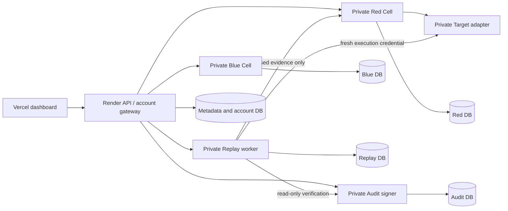

# Production architecture

Red submits only a nonce-protected commitment and allow-listed execution observation to orchestration. Raw prompts/responses stay in Red storage; rules stay in Blue storage. The Target has no database or team-volume credentials. Audit alone receives the persistent signing key. Replay receives read-only credentials for sealed evidence and a separate Target token.

The authenticated gateway forwards Red submissions and post-close auditor reveals, so their plaintext transits its memory. Its production database rejects raw evidence content. The gateway, hosting control plane and database administrators remain trusted.

Render isolates public ingress for private services, but shares private networking within a workspace/region. The Compose profile defines stricter per-pair networks and runtime limits. See [production deployment](production-deployment.md) and [PLAN verification map](plan-review.md).
